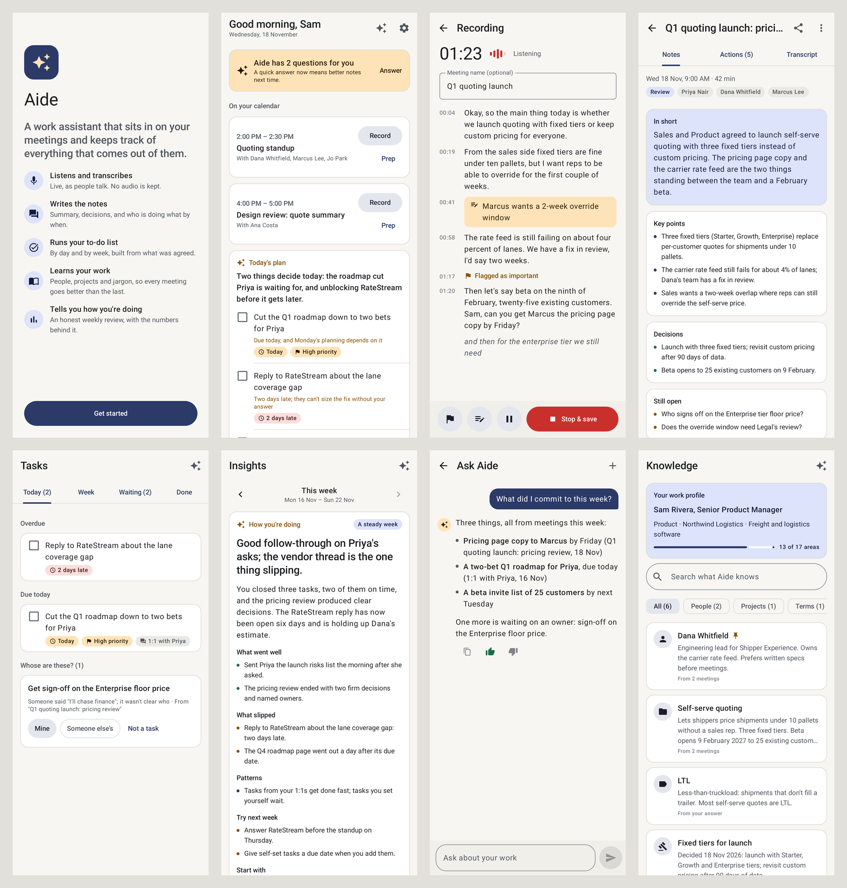
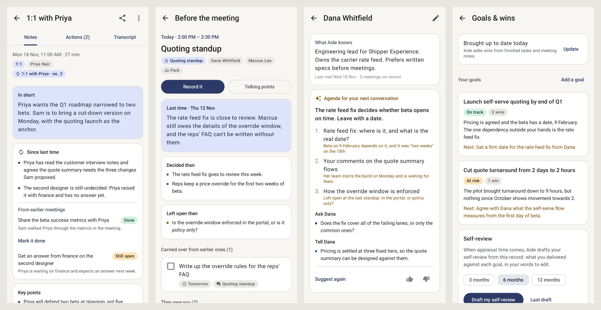
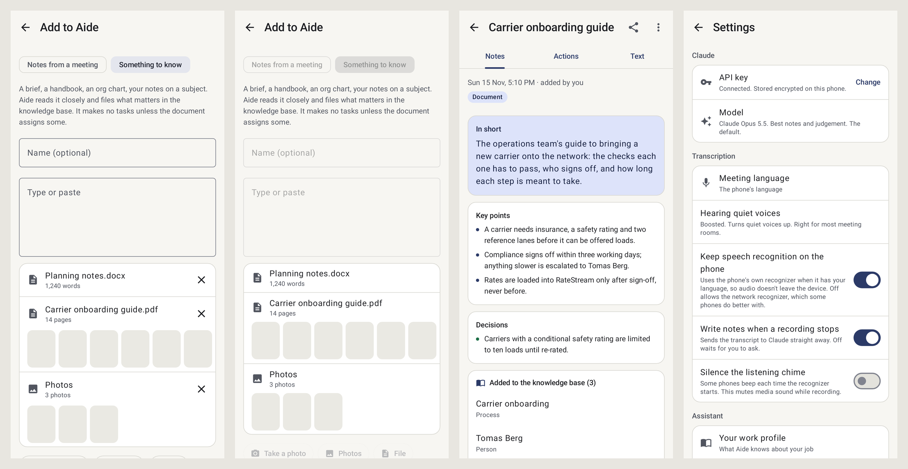

# Aide

A personal work assistant for Android. It sits in on your meetings, transcribes them live, writes up the notes, and keeps everything that comes out of them: the to-do list by day and by week, a knowledge base about your work, and an honest read on how you are doing.

This is a separate app from Yoked (the project at the root of this repository). It has its own Gradle project in this folder and shares nothing with it.

Kotlin, Jetpack Compose, Material 3, Room, DataStore, the official Anthropic SDK. Minimum Android 8 (API 26); live transcription is at its best on Android 13 and later.







The screens above are rendered from the app's own code with a sample week of data (`./gradlew recordRoborazziDebug`).

## What it does

- **Live transcription.** Tap Record and put the phone on the table. Words appear as people speak, using the phone's own speech recognizer (the one behind voice typing), on the device where the phone supports that. On Android 13 and later Aide captures the microphone itself and turns quiet voices up before the recognizer hears them, and it tells the recognizer which names and terms to listen out for, taken from your profile and knowledge base. No audio is ever saved. You can pause, type a note ("Dana owns the rate feed"), or flag a moment as important; notes are trusted over what was heard. Recording carries on with the screen locked, behind a notification with Pause and Stop.
- **Meeting notes.** When a recording stops, Claude writes a short summary, key points, decisions, open questions, risks, and the action items: who took what on, by when. A follow-up email is one tap away. A transcript from Zoom, Teams or Meet, or your own notes, gets the same treatment (next point).
- **Bring in your own notes, documents and photos.** "Add to Aide" takes what you type or paste, files (PDF, Word .docx, text), and photographs of handwritten notes, a whiteboard or printed pages, from the camera, the gallery, or shared from another app. Say whether it is notes from a meeting (written up with decisions and action items) or something to know (a brief, a handbook, an org chart: read closely and filed in the knowledge base, with no tasks). Claude reads pictures and PDF pages into text; the text is kept and searchable, the pictures are not.
- **To-dos by day and by week.** Action items become tasks. Yours go on Today and Week; other people's go under Waiting so you can chase them; ones where the transcript didn't settle the owner wait for one tap from you. "Plan my day" and "Plan my week" have Claude pick and order what matters, with reasons. Tasks can also be added by hand.
- **Knowledge base.** After each meeting Aide saves what is worth keeping: who people are and what they own, what a project is and where it stands, what an acronym means, what was decided and why. It reads the relevant entries before every meeting and every answer, and updates an entry instead of duplicating it. Everything is searchable and editable.
- **Onboarding that builds the dataset.** First run asks for your role, company, industry and department, then Claude interviews you about your work: responsibilities, projects, the people you deal with, your regular meetings, vocabulary, how you are judged. For your first five meetings it also asks follow-up questions about names and terms it couldn't place; each answer goes into the knowledge base.
- **Performance overview (Insights).** The week in numbers, counted from your own data: tasks completed, share done on time, what is overdue, what you are waiting on, time in meetings. On top of that Claude writes a weekly review: what went well, what slipped, patterns, what to try next week, and a status update ready to send to your manager. The same screen shows how Aide itself is doing: how many of its notes you rated right, how many of the tasks it spotted you kept, and roughly what it has cost.
- **Collect notes dictated in another app.** If another app's voice typing hears your meetings better than the phone's recognizer does, let it do the listening. Tap "Start collecting" under Add to Aide, then after each stretch copy what the other app wrote and tap "Add copied text" on Aide's notification, without leaving that app. Sharing the text to "Add to Aide notes" does the same. The parts go into one meeting in order; if you copy the whole box each time, only what is new is added. "Finish" has Claude write the meeting up.
- **Recurring meetings as one thread.** A 1:1 or a standup is linked to the last time it was held, by its calendar event or by Claude recognising it, and you can link one yourself or say a meeting isn't one, which sticks. Its notes open with "Since last time": what has moved, and where each action item from the earlier meetings stands, with one tap to close the ones the meeting said were done. Unfinished items carry over instead of being listed again.
- **A page per person.** Tap a name anywhere: what Aide knows about them, what they owe you, what you have open with them, the meetings you have had, and an agenda for your next conversation that Claude suggests from all of that. "Draft a nudge" writes the chase-up for you.
- **Goals and wins.** A running record of what you achieved, filed under the goals in your profile. Add wins yourself, or have Claude bring the log up to date from finished tasks and meeting notes and say where each goal stands. At appraisal time it drafts your self-review from that record.
- **Briefs and nudges.** Ten minutes before a calendar meeting, a notification with what was decided last time and what is still open with the people in it, and a button to start recording. In the afternoon, a reminder of what is still due today, and a nudge when something you are waiting on has gone quiet for five days. All of it is worked out on the phone, with no Claude call.
- **Ask Aide.** A chat that answers from your meetings, tasks and knowledge base: "What did I commit to this week?", "Prep me for my 2:00 with Dana", "Draft a status update".
- **Around the edges.** Read-only calendar connection (names recordings after the meeting you are in, shows the day, one-tap prep), an optional morning brief notification, backup and restore to a file, light and dark themes.

### Permissions

Microphone (to transcribe), notifications (the recording controls, briefs and reminders), calendar (read-only, optional), exact alarms (so a meeting's brief arrives ten minutes before it and not whenever the phone next wakes), and run-at-startup (to set those alarms again after the phone restarts). Internet is used only to reach the Anthropic API. Photos are taken with the phone's own camera app, so Aide asks for no camera permission, and files and pictures are picked through the phone's own pickers, so it sees only what you choose.

## What you need

**A Claude API key.** Transcription and manual tasks work without one, but notes, plans, reviews and answers are written by Claude through the Anthropic API, with your own key from the [Claude Console](https://console.anthropic.com/settings/keys). This is billed per use to that account and is separate from a Claude subscription (Pro or Max); a subscription cannot be used by an app. By the list prices of November 2026, writing up an hour-long meeting costs roughly 10 to 25 cents with the default model (Opus 5.5), about half that with Sonnet 5.5 and around a cent with Haiku 5.5; Insights keeps a running estimate. The key is encrypted with the phone's hardware-backed keystore and can be changed or removed in Settings.

**A phone with speech recognition.** Nearly every Android phone has one (Google's "Speech Recognition & Synthesis"). In Settings you can choose the meeting language and whether recognition must stay on the device.

## Install

Build the APK (below) or take `aide.apk` from wherever this build was shared, copy it to the phone, and open it. Android will ask you to allow installing from that source the first time. Later builds install over earlier ones and keep your data, because every build is signed with the same key.

## Privacy

Everything Aide stores is on the phone, in the app's private storage, and is excluded from cloud backups. Speech is turned into text as it is heard and the audio is discarded; when Aide captures the microphone itself the audio only ever exists in memory, on its way to the phone's recognizer. When Claude is asked for notes, a plan or an answer, the transcript and the relevant tasks and knowledge entries are sent to the Anthropic API with your key, and nowhere else. Pictures and PDF pages you add are sent the same way to be read, then deleted from the phone's cache; documents and text files are read on the phone. There is no account, no server of ours, no analytics.

Tell people when you are transcribing a meeting. In many places the law requires everyone's consent, and many employers have their own rules about recording and about sending work conversations to an outside service.

## What to expect from transcription

The phone's recognizer was built for someone dictating into the phone, not for a room. Left to open the microphone itself it hears people across a table faintly and drops much of what they say. So by default (Settings > Hearing quiet voices) Aide opens the microphone itself, boosts quiet speech by up to 16 times (40 on "Maximum") while leaving background hiss alone, keeps one capture running for the whole meeting so no words fall between recognition sessions, and hands the recognizer that. Not every phone's recognizer accepts audio handed to it; if yours refuses, or takes it and makes nothing of it, Aide goes back to the recognizer's own handling within a few seconds and remembers that. This path has been tested here for its plumbing, on an emulator and against a simulated recognizer, not with real voices in a real room: try it in your next meeting, and if it is worse than before, choose "Leave it to the phone".

Claude itself cannot do the transcribing: the Claude API takes text, pictures and PDFs, not audio. The voice typing inside the Claude app is a feature of that app and can't be called from another one, which is what "Collect notes dictated in another app" is for: the other app listens, and its text is brought across in parts. Getting the accuracy of a server-grade speech model inside Aide would mean adding a separate speech-to-text service with its own key and cost.

The recognizer hears one microphone and does not know who is speaking, so transcripts have no speaker labels, and names and jargon are sometimes misheard. Aide is built around that: Claude is told how the transcript was made, repairs mis-hearings from the knowledge base, and marks a task's owner as unclear instead of guessing. Typed notes and the answers you give to Aide's questions make the biggest difference to accuracy. A phone close to the speakers in a quiet room does much better than one across a table in a noisy one.

## Known limits

- No speaker labels, and no audio is kept, so a transcript can't be re-listened to or re-transcribed.
- Transcription depends on the phone's recognizer. It has been exercised here against a simulated recognizer and on an emulator, not with real speech in a real room; expect to tune the language and the "keep recognition on the phone" setting on first use.
- Notes are written after the meeting, not during it, and need a connection to reach Claude.
- Reading pictures and PDFs costs roughly 2 to 3 cents a page with the default model, and a PDF is read up to 60 pages at a time. Old Word files (.doc), spreadsheets and slides aren't opened: save them as PDF first. Handwriting is read as well as Claude can; words it can't make out are marked, not guessed.
- If the phone's clocks change, the morning brief and the afternoon reminders arrive an hour off until the next time they run or their switch is flipped in Settings.
- Meeting briefs follow the calendar on the phone, which Aide re-reads every few hours and whenever it is opened. A meeting added or moved at the last minute may get no brief, and phones with aggressive battery saving can delay or drop reminders; exempting Aide from battery optimisation helps.
- People are matched by name. A first name on its own ("Chris will send it") is credited to a person only when nobody else Aide knows of shares it; otherwise the task shows no page until its owner is spelled out. Nicknames and different spellings of one name are treated as different people.
- The wins log and the self-review are drafted from what Aide has seen: recorded meetings, tasks, and what you add yourself. Work that never passed through the app is not in them unless you log it.
- One phone, no sync. Use Settings > Save a backup to move to another phone; the API key is not in the backup.

## Build

```
./gradlew assembleRelease        # app/build/outputs/apk/release/app-release.apk
```

Needs JDK 17 or later and the Android SDK (platform 37); `local.properties` should point at the SDK (`sdk.dir=...`). The release build is not minified: the Claude SDK relies on reflection, and a larger, predictable APK was preferred to a smaller one that cannot be exercised on a phone from here.

`app/signing/aide.keystore` is a fixed signing key kept in the repository so that a build from any machine installs over the last one. It is fine for a personal, sideloaded app; replace it before distributing the app to anyone else.

## Tests

```
./gradlew testDebugUnitTest          # logic, database, the Claude client against a local stand-in, transcription
./gradlew recordRoborazziDebug       # renders every screen to app/build/outputs/roborazzi
./gradlew connectedDebugAndroidTest  # on a phone or emulator: the SDK on Android, the keystore, the recording service
```

The unit tests never call the real Claude API: a local web server plays its part, so they cost nothing and need no key. The on-device tests do the same on Android. `SeedDemoData` (an on-device "test" that only runs when asked for by name) fills the debug build with a sample week to look at.

## How it is put together

| Package | What is in it |
|---|---|
| `ai` | `AnthropicLlm` (the Claude client: streaming, structured outputs, refusal fallbacks), `Prompts`, `Schemas` (the JSON shapes Claude replies in), `ContextBlocks` (what is sent with each request), `Assistant` (one function per job), `MeetingProcessor` |
| `transcribe` | `AndroidSpeechTranscriber` (keeps the recognizer going for a whole meeting), `Recorder`, `RecordingService` |
| `data` | Room database, settings and work profile (DataStore), the encrypted key store, backup |
| `domain` | Pure logic: the task board, the performance numbers, keyword retrieval, who a name refers to, the pre-meeting brief, dates, export |
| `calendar`, `notify` | Read-only calendar access; notifications, the morning brief, meeting briefs and afternoon reminders |
| `ui` | One folder per screen |

The model defaults to Claude Opus 5.5 and can be switched to Sonnet 5.5 or Haiku 5.5 in Settings. Claude is never given tools: each request carries the context that code selected for it (retrieval runs on the phone), so a request can only ever read what it was sent.
