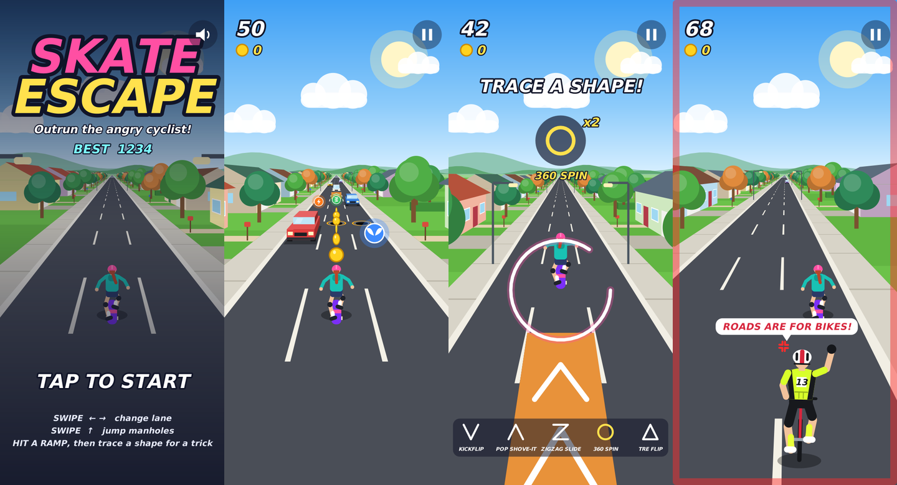

# Skate Escape

An endless runner for Android. You are a skater girl on a neighbourhood road, and a furious cyclist in full kit (helmet, lycra, race number) is chasing you.



*These frames were drawn by the game's own renderer on a computer, not captured from a phone.*

## How to play

| Do this | To |
| --- | --- |
| Swipe left or right | Change lane (three lanes) |
| Swipe up | Jump |
| Swipe down in the air | Drop back to the road quickly |
| Trace a shape while in the air off a ramp | Do a trick |
| Tap the top-right button | Pause (on the title screen it turns sound on or off) |

- **Cars** drive down the road toward you. Switch lanes to avoid them. Hitting one head-on ends the run; clipping one while changing lanes only makes you stumble.
- **Open manholes** have an orange ring. Jump them. Rolling into one makes you stumble.
- **Stumbling** lets the cyclist catch up, and the screen edge glows red while he is close. Stumble again before he drops back and you are busted.
- **Ramps** launch you into the air and time slows down. Trace one of the five shapes shown along the bottom of the screen to do its trick for coins. The shape in the circle pays double, you can fit up to three tricks into one jump, and landing tricks on ramp after ramp builds a combo bonus.

| Shape | Trick | Coins |
| --- | --- | --- |
| V | Kickflip | 8 |
| ^ | Pop shove-it | 8 |
| Z | Zigzag slide | 10 |
| Circle | 360 spin | 12 |
| Triangle | Tre flip | 15 |

- **Power-ups:** the orange bolt is Turbo (faster, and the cyclist falls back sooner), the green spring is Super Jump (high enough to clear cars), and the blue wings let you fly above everything through a trail of coins.
- **Score** is metres skated plus 10 per coin. The best score is kept on the phone.

## Build and install

From the repository root, with the Android SDK set up as described in the main README:

```
./gradlew :skater:assembleDebug
adb install -r skater/build/outputs/apk/debug/skater-debug.apk
```

`./gradlew :skater:testDebugUnitTest` runs the rule and shape-recognition tests.

## How it is made

Kotlin with no libraries and no image or sound files: everything on screen is drawn with `Canvas`, and the sound effects are generated when the app starts. The app asks for no permissions.

- `game/World.kt` holds all the rules and has no Android code in it, so it is tested directly.
- `game/Gesture.kt` recognises the traced shapes.
- `Renderer.kt` draws the scene with a simple perspective camera.
- `GameView.kt` runs the frame loop and turns touches into swipes and shapes.
- `Sfx.kt` makes the sound effects.
