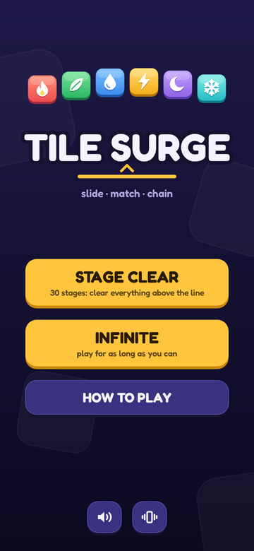
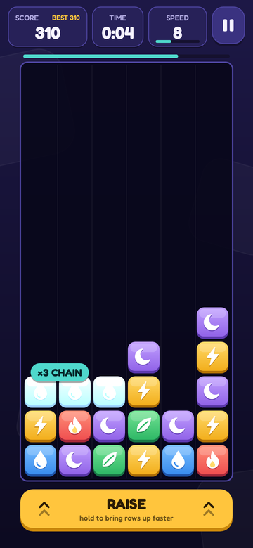
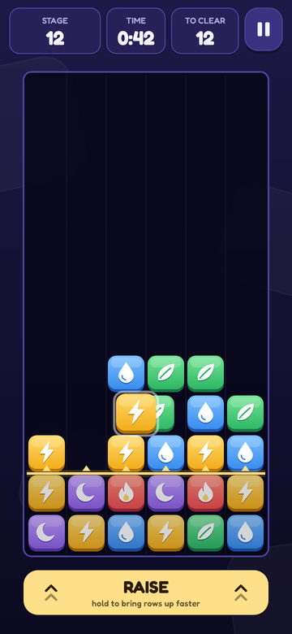
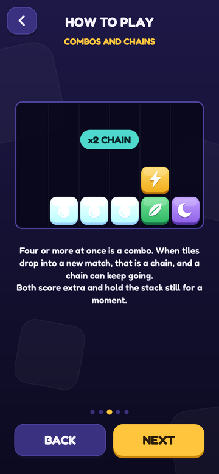

# Tile Surge

A touch-screen puzzle game for Android in the tile-swapping, rising-stack style: slide tiles sideways, line up three or more, and keep the stack from reaching the top. It is its own game. The name, the six tiles, the sounds, the stage list and all of the code were made for it; nothing is taken from any other game.

Kotlin, drawn on a plain Android `Canvas`, no libraries. Minimum Android 8 (API 26), targets Android 17 (API 37). No permissions, no network, no ads.

| | | | |
| --- | --- | --- | --- |
|  |  |  |  |

## How it plays

- **Slide.** Put a finger on a tile and slide it left or right. It swaps with its neighbour, one cell at a time, and follows the finger across as many cells as you like. Tiles only move sideways. Slide one over a drop and it hangs for a moment, then falls.
- **Match.** Three or more of the same tile in a row or a column flash, pop one by one, and vanish together. Whatever was resting on them falls.
- **Combos.** Four or more cleared at once is a combo.
- **Chains.** When tiles that fall after a clear land in a new match, that is a chain, and it can keep going (×2, ×3, ...). You can line tiles up while a group is still flashing so that what falls next completes a match.
- **The stack rises.** New rows come up from below all the time. The stack waits while tiles are moving or popping, and combos and chains hold it still for a few seconds more (the teal bar above the well).
- **RAISE.** Hold the button under the well to bring rows up faster. A quick tap brings exactly one row. One finger can hold RAISE while another slides tiles.
- **The top.** When a tile is in the top row the stack stops and a red bar runs down. Clear the top row before it runs out or the game is over.

**Stage Clear** has 30 stages. In each one a clear line is on its way up from below; once it is in the well, clear every tile above it. Stages get faster and longer, and the last ten add a sixth tile. A stage opens when the one before it is cleared, and each keeps your best time.

**Infinite** has no end. Choose Easy, Normal or Hard and a starting speed; the speed goes up as you clear tiles. Each difficulty keeps its best score.

How to Play, on the title screen, shows all of this with small boards that play themselves.

## Put it on your phone

You need `app-debug.apk`, either the one from the Claude session or one you build (below).

- **With a cable:** turn on Developer options and USB debugging on the phone, plug it in, then run
  `adb install -r app/build/outputs/apk/debug/app-debug.apk`
- **Without a cable:** send the APK to yourself (Google Drive, email), open it on the phone, and allow "Install unknown apps" for the app you opened it from when Android asks.

Android may show a Play Protect warning for an app it has not seen before. That is expected for a personal build.

**Updating:** build again and install over the top. Best scores and stage progress stay, because every build is signed with the same key (`app/signing/debug.keystore`, kept in the repo for that reason; it is for sideloading only, not for a store).

## Build it

This folder is a complete Gradle project of its own; it does not depend on the Meal & Gym app next to it.

1. Install a JDK (17 or newer) and the Android SDK (Android Studio, or just the command-line tools). The build needs SDK platform 37; Gradle downloads the rest itself.
2. Point the build at the SDK: set `ANDROID_HOME`, or put `sdk.dir=/path/to/Android/sdk` in `tile-surge/local.properties`.
3. In this folder, run `./gradlew assembleDebug` (on Windows, `gradlew.bat assembleDebug`).
4. The APK is at `app/build/outputs/apk/debug/app-debug.apk`.

In Android Studio, open the `tile-surge` folder itself, not the repository root.

## Tests

`./gradlew testDebugUnitTest` runs everything, with no phone or emulator needed:

- **The rules** (`core/RulesTest`): one test per rule, on hand-written boards: swapping, hanging and falling, matching, pop order and timing, combos, chains, rising, RAISE, the top of the well, speeding up, the clear line.
- **Random play** (`core/FuzzTest`): millions of frames of random touches, checking after every frame that the board still makes sense (nothing floating, nothing left matched, nothing stuck in mid-air).
- **Whole games** (`core/BotTest`): a simple computer player clears all 30 stages and plays Infinite on each difficulty, and prints how long it took.
- **Touch** (`ui/TouchPlayTest`, `ui/NavigationTest`): the real view driven by simulated fingers: sliding, flicking, two fingers at once, pause, the menus, a whole stage and a whole Infinite game played through touch events only.
- **The how-to boards and the sounds** (`ui/DemosTest`, `ui/SfxSynthTest`).
- **Pictures** (`ui/ScreensTest`): draws every screen with the real drawing code and saves PNGs to `app/build/outputs/screens/`, at phone, small-phone and tablet sizes.

`./gradlew lintDebug` is clean.

## Where things are

```
app/src/main/java/com/personal/tilesurge/
  core/            The game itself, with no Android code in it.
    Game.kt          The well and every rule; tick() is one frame at 60 a second.
    Rules.kt         Difficulty timings, the speed table, scoring, the 30 stages.
    Tile.kt, GameEvent.kt, Rng.kt
  ui/              Everything on screen.
    GameView.kt      The one view: the 60-a-second clock, touch, safe area.
    PlayScene.kt     The game screen: touch handling, readouts, RAISE, effects, pause and result panels.
    BoardRenderer.kt The well and its tiles.
    TileArt.kt       The six tiles, drawn from shapes in code.
    TitleScene.kt, InfiniteSetupScene.kt, StageSelectScene.kt, HowToScene.kt, Demos.kt
    Ui.kt            Colours, text, buttons, icons.
    SfxSynth.kt, Sound.kt   Sound effects, made from tones in code (there are no audio files).
    Prefs.kt         Saved settings, best scores and stage progress.
  MainActivity.kt    Full screen, Back, pause when the app leaves the front.
app/src/main/res/font/   Fredoka (SIL Open Font License, see licenses/)
```

## The numbers

All times are frames at 60 a second.

| | Easy | Normal | Hard |
| --- | --- | --- | --- |
| Different tiles | 5 | 5 | 6 |
| A tile hangs before it falls | 14 | 12 | 9 |
| A match flashes, then pauses | 46 + 18 | 44 + 16 | 36 + 13 |
| Between one pop and the next | 10 | 9 | 8 |
| Time allowed against the top | 180 | 120 | 80 |
| Pause earned by combos and chains | ×1.5 | ×1 | ×0.7 |

- **Swapping** takes 4 frames; falling is one cell a frame; RAISE brings a row in 15 frames.
- **Speed** goes from level 1 (a row every 15 seconds) to level 50 (a row every 0.75 seconds), about 6% faster each level. In Infinite, level `n` takes `9 + n` cleared tiles to pass.
- **Score:** 10 a tile; a combo of `n` adds `10 × (n − 3) × (n − 2)`; step `k` of a chain adds `50 × (k − 1)²`; 1 for every row raised by hand.
- **Stages:** stage `n` has its line `6 + ¾(n − 1)` rows down and runs at speed `1 + ⅘(n − 1)`; stages 1 to 10 use the Easy timings, 11 to 20 Normal, 21 to 30 Hard with six tiles.

## Choices made along the way

- **Raising at the top is safe.** RAISE does nothing while a tile is in the top row, rather than ending the game on the spot. The red countdown still runs.
- **A tap finishes its row.** Letting go of RAISE part-way up a row lets that row finish coming in, so a tap is always worth exactly one row.
- **Nothing can be slid in right under a hanging tile.** It has to fall first. Without this, one tile shuffled between two columns could hold them both up for ever and stop the stack rising. (A test bot found that; it is now a rule with its own test.)
- **A dropped tile finishes its trip.** If the finger lifts while the tile is still catching up, the tile carries on to the column where the finger left it.
- **Forgiving touches.** A touch that lands just above or just beside a tile picks that tile up, and a tile keeps the grip the finger took on it, so it takes the same half-cell of movement to shift it whichever part of it was touched.
- **Upright on phones.** On tablets and wide windows the readouts move to the left of the well and RAISE to the right.

## Not in this version

Music, saving a game in progress when the app is closed, a versus mode and puzzle stages with a fixed number of moves.
